<div align="center">

<p align="center">
  
</p>

# ⚡ ThinkPro Vantage

### The Ultimate ThinkPad Companion Utility for Linux

**Hardware Fan Curves • Dual-Battery Thresholds • CPU Governors • Native PAM Biometrics • AI Model Context Protocol (MCP)**

<p align="center">
  
  
  <a href="./LICENSE">
    
  </a>
  <a href="https://arkhimuttaqina.github.io/thinkpro-vantage/">
    
  </a>
</p>

<p align="center">
  <a href="#-key-features">Key Features</a> •
  <a href="#-ui-showcase">UI Showcase</a> •
  <a href="#-installation">Installation</a> •
  <a href="#-thinkpad-hardware-setup">Hardware Setup</a> •
  <a href="#-pam-security--health-cli">PAM CLI</a> •
  <a href="#-ai-integration-mcp-server">MCP Server</a> •
  <a href="#-building-from-source">Development</a>
</p>

---

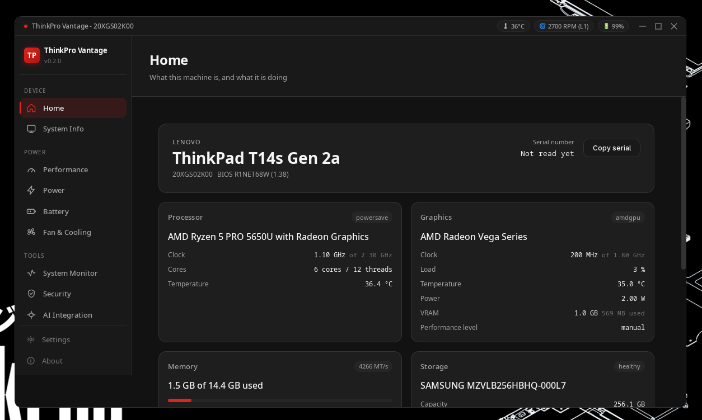

</div>

<br/>

## 📖 Overview

**ThinkPro Vantage** is a high-performance, native desktop utility tailored specifically for IBM & Lenovo ThinkPad hardware. Powered by a lightweight **Rust** backend and **Tauri v2**, ThinkPro Vantage gives you granular control over thermal fan curves, charge thresholds, CPU governors, and system telemetry—all packaged in a sleek dark interface inspired by ThinkPad's iconic design language.

Whether you need whisper-quiet operation in a quiet library, maximum thermal dissipation during heavy compilation, or prolonged battery lifespan on the go, ThinkPro Vantage gives you full command of your hardware without clunky scripts or terminal juggling.

---

## ✨ Key Features

| Feature | Description |
| :--- | :--- |
| 🌀 **Intelligent Fan Control** | Direct hardware EC interface via `thinkpad_acpi`. Custom interactive temperature-to-RPM curves, auto/manual steps (0–7), full blast, and automated safety watchdog re-arming. |
| 🔋 **Battery Health & Thresholds** | Prolong battery life using the 40–80% charging cycle rule. Set custom start/stop charge limits with multi-battery support, degradation metrics, and cycle counts. |
| ⚡ **Performance & CPU Profiles** | Live scaling policy switching (`performance`, `powersave`, `schedutil`, `ondemand`), Intel Turbo Boost toggle, Energy Performance Preference (EPP), and per-core clock monitoring. |
| 📊 **Real-Time System Telemetry** | Comprehensive live dashboards for per-core CPU loads, memory & swap allocation, storage mount points, network interface throughput, and top active processes. |
| 🛡️ **Biometrics & Security Suite** | Native fingerprint enrollment, ClamAV antivirus scanning, and built-in PAM health verification & recovery tooling (`--check-pam`, `--repair-pam`, `--rollback-pam`). |
| 🤖 **AI Model Context Protocol (MCP)** | Built-in SSE MCP server allowing AI assistants (Claude Code, Claude Desktop, Cursor) to inspect telemetry, adjust fan curves, and tune performance parameters safely. |
| 🐧 **Linux-Native** | Debian/Ubuntu (`.deb`), Fedora/RHEL (`.rpm`), and universal `.AppImage` packages. |
| ☁️ **Settings Sync & Backup** | Export and import your finely tuned configurations to JSON, or back them up seamlessly to Google Drive. |

---

## 📸 UI Showcase

<div align="center">

| 🌀 Fan Control & Curve Editor | 🔋 Dual-Battery Management |
| :---: | :---: |
| 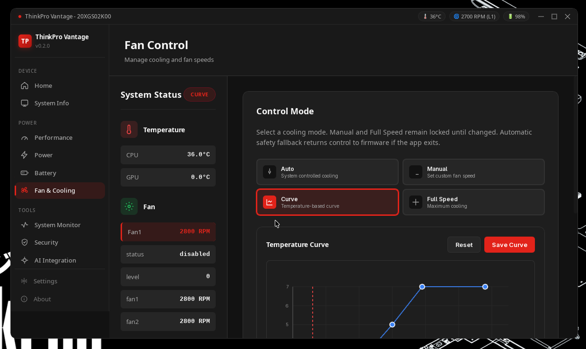 | 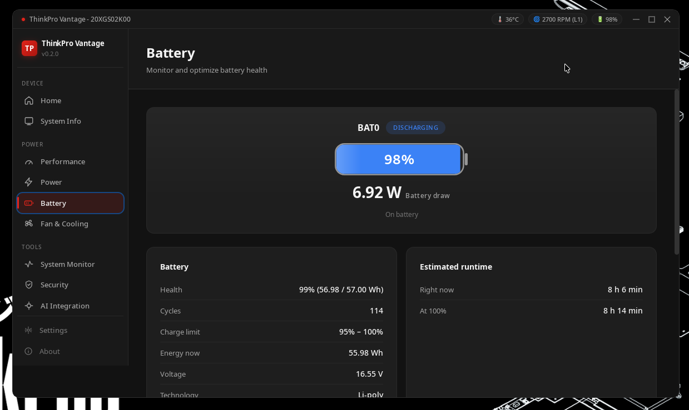 |
| **⚡ CPU Clock Limits** | **⚡ GPU LACT Clock Limits** |
| 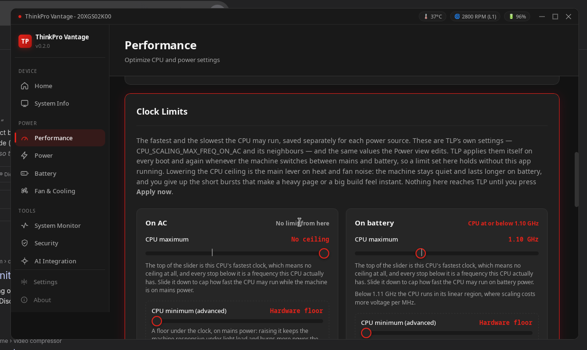 | 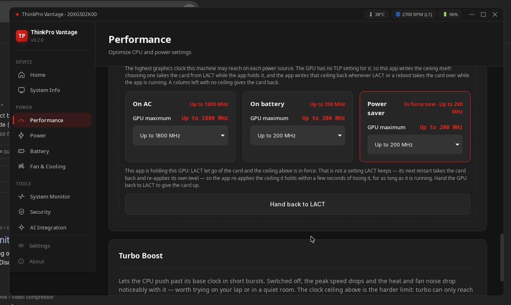 |
| **🔌 Power Daemon (TLP/PPD)** | **📊 System Resources & Processes** |
| 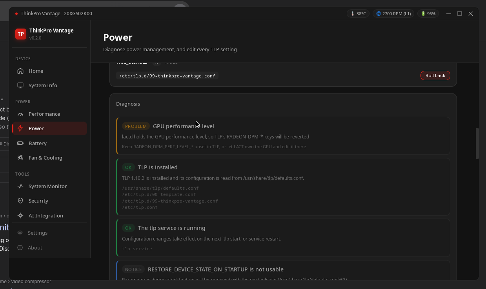 | 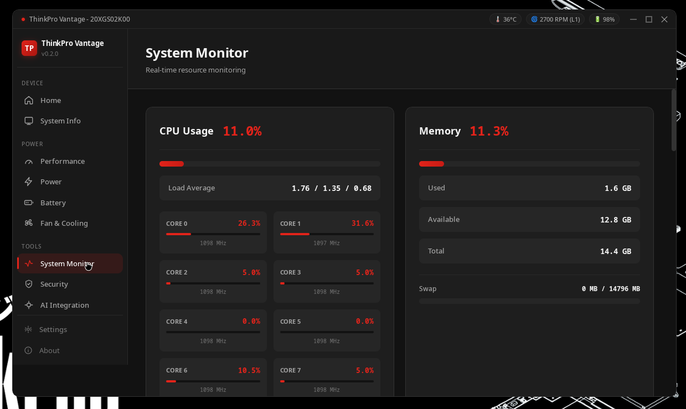 |
| **🛡️ Security & Biometrics** | **🤖 AI Integration (MCP Server)** |
| 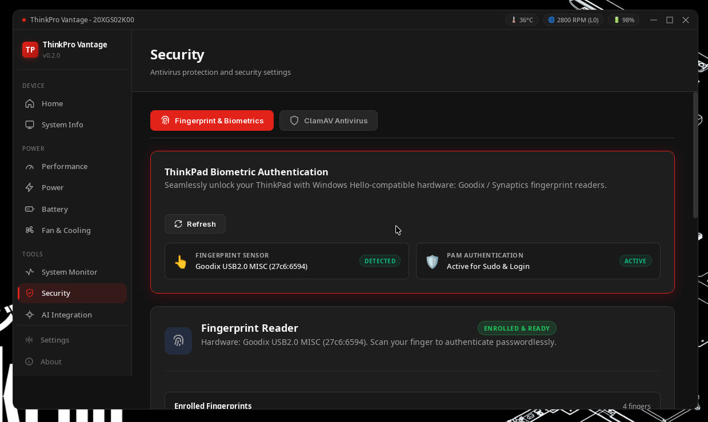 | 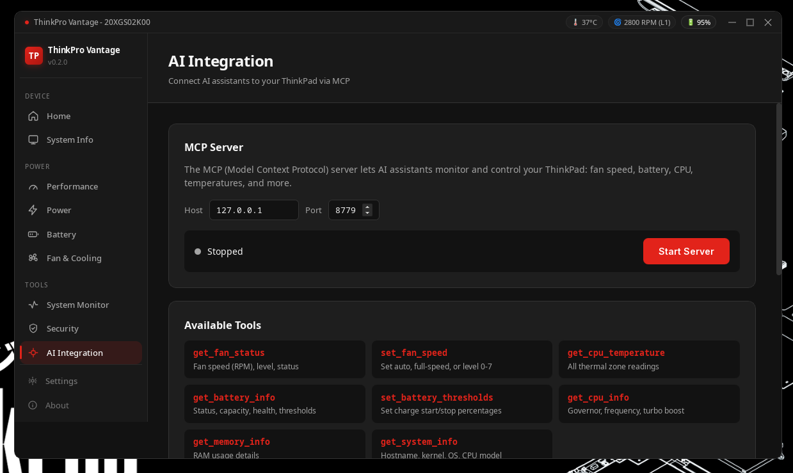 |
| **💻 Hardware & Kernel Info** | **⚙️ GNOME Extension Install** |
| 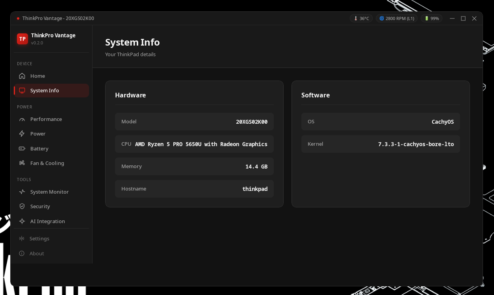 | 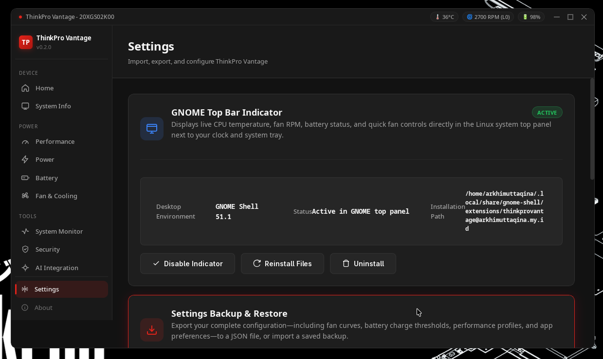 |

</div>

---

## 🚀 Installation

Prebuilt release binaries for Linux (`.deb`, `.rpm`, `.AppImage`) are available on the [**GitHub Releases Page**](https://github.com/ArkhiMuttaqina/thinkpro-vantage/releases).

### 🐧 Ubuntu / Debian / Pop!_OS / Linux Mint

**Option 1: Using APT Repository**
```bash
echo "deb [trusted=yes] https://arkhimuttaqina.github.io/thinkpro-vantage/apt ./" | sudo tee /etc/apt/sources.list.d/thinkpro-vantage.list
sudo apt update
sudo apt install thinkpro-vantage
```

**Option 2: Direct .deb Package**
```bash
# Download the latest thinkpro-vantage_*.deb from Releases
sudo dpkg -i thinkpro-vantage_*.deb
sudo apt install -f  # resolve any missing dependencies if needed
```

### 🔴 Fedora / RHEL / Rocky Linux
```bash
# Download the latest thinkpro-vantage-*.rpm from Releases
sudo dnf install ./thinkpro-vantage-*.rpm
```

### 📦 Universal Linux (AppImage)
```bash
chmod +x thinkpro-vantage_*.AppImage
./thinkpro-vantage_*.AppImage
```

## 🔧 Recommended Setup

ThinkPro Vantage is built to coordinate with the tools below. Each is optional on
its own, but together they let every page run at full strength:

| Component | What it enables |
|-----------|-----------------|
| **TLP** | Power management and battery charge thresholds — the Power page auto-detects TLP vs `power-profiles-daemon` |
| **AMD P-State EPP** (AMD) / **Intel P-State HWP** (Intel) | The kernel CPU frequency driver the governor, boost toggle, and CPU clock ceilings sit on top of |
| **LACT** | AMD GPU clock control — ThinkPro Vantage detaches the card, writes the ceiling, and re-applies it on AC/battery switches |
| **polkit + `thinkpro-ctl`** | Passwordless fan control — a one-time `pkexec` setup installs the helper and scopes the polkit rule to it, so `/proc/acpi/ibm/fan` writes never prompt twice |

**Fan control setup:** run the one-time permission setup from the Permissions
page (or the packaged install step). It installs `thinkpro-ctl` and a polkit
rule that matches only that helper, so fan changes are passwordless while the
privileged surface stays a fixed set of verbs.

---

## ⚙️ ThinkPad Hardware Setup

To allow ThinkPro Vantage to directly read and control your cooling fan hardware on Linux:

1. Create or edit the `thinkpad_acpi` kernel module configuration:
   ```bash
   sudo nano /etc/modprobe.d/thinkpad_acpi.conf
   ```

2. Add this configuration directive:
   ```ini
   options thinkpad_acpi fan_control=1
   ```

3. Reload the module (or reboot your laptop):
   ```bash
   sudo modprobe -r thinkpad_acpi
   sudo modprobe thinkpad_acpi
   ```

4. Verify that the fan interface is active:
   ```bash
   cat /proc/acpi/ibm/fan
   ```

---

## 🛡️ PAM Security & Health CLI

ThinkPro Vantage includes an enterprise-grade PAM configuration analyzer and repair engine designed to prevent and recover from authentication lockout issues (such as malformed PAM extended control syntax):

```bash
# Audit PAM authentication configuration health
thinkpro-vantage --check-pam

# Safely sanitize, repair, and validate system PAM configurations
thinkpro-vantage --repair-pam

# Roll back PAM configuration to the latest verified automatic backup
thinkpro-vantage --rollback-pam

# Display CLI help
thinkpro-vantage --help
```

---

## 🤖 AI Integration (MCP Server)

ThinkPro Vantage embeds a native **Model Context Protocol (MCP)** server on `http://127.0.0.1:3000/sse`. This enables AI assistants (such as Claude Code, Claude Desktop, Cursor, or OpenCode) to inspect thermal sensors and adjust system parameters on your behalf.

### Claude Desktop Configuration
Add this to your `claude_desktop_config.json`:

```json
{
  "mcpServers": {
    "thinkpro-vantage": {
      "command": "npx",
      "args": ["-y", "@modelcontextprotocol/server-sse", "http://127.0.0.1:3000/sse"]
    }
  }
}
```

---

## 🛠️ Building from Source

### Prerequisites
- **Rust** 1.70+ (`curl --proto '=https' --tlsv1.2 -sSf https://sh.rustup.rs | sh`)
- **Node.js** 22+ & `npm`
- **Linux Packages**: `build-essential libwebkit2gtk-4.1-dev libgtk-3-dev libayatana-appindicator3-dev librsvg2-dev patchelf`

### Build Instructions
```bash
# 1. Clone repository
git clone https://github.com/ArkhiMuttaqina/thinkpro-vantage.git
cd thinkpro-vantage

# 2. Install dependencies
npm ci

# 3. Launch in development mode
npm run tauri dev

# 4. Build production packages
npm run tauri build
```

The resulting packages will be in `src-tauri/target/release/bundle/`.

### Code Quality & Linting
```bash
npm run validate     # Runs ESLint, Stylelint, HTMLHint, and Prettier check
cargo test           # Runs all 147+ Rust integration & safety test suites
```

---

## 📐 Architecture

```
ThinkPro Vantage/
├── src/                          # Modern vanilla JS/CSS/HTML frontend
│   ├── index.html                # App shell
│   ├── styles/                   # Scoped modular stylesheets
│   ├── js/                       # Modular ES6 controllers
│   │   ├── app.js                # Lifecycle & navigation
│   │   ├── fanCurve.js           # Canvas interactive curve engine
│   │   └── views/                # Views (fan, battery, monitor, security, mcp)
│   └── templates/                # Modular HTML view templates
├── src-tauri/                    # Rust native backend
│   ├── src/
│   │   ├── fan_control.rs        # Manual fan speed & EC control
│   │   ├── fan_curve.rs          # Background thermal curve supervisor & watchdog
│   │   ├── battery.rs            # Charge thresholds & sysfs interfaces
│   │   ├── performance.rs        # CPU governors, EPP, and Turbo Boost
│   │   ├── monitor.rs            # Real-time resource telemetry
│   │   ├── pam.rs                # PAM configuration validator, repair & rollback
│   │   ├── biometrics.rs         # Fingerprint authentication management
│   │   ├── security.rs           # ClamAV scanner integration
│   │   └── mcp.rs                # Built-in Model Context Protocol server
│   └── Cargo.toml
├── .github/workflows/            # Continuous Integration & multi-platform releases
└── docs/                         # Detailed VitePress documentation
```

---

## 🤝 Contributing

Contributions are warmly welcomed! Please feel free to submit a Pull Request or file an issue:
1. Fork the repository
2. Create a feature branch (`git checkout -b feature/amazing-feature`)
3. Ensure tests pass (`npm run validate` and `cargo test`)
4. Commit your changes (`git commit -m 'feat: add amazing feature'`)
5. Push to the branch (`git push origin feature/amazing-feature`)
6. Open a Pull Request

---

## 🙏 Credits

ThinkPro Vantage continues [ThinkUtils](https://github.com/TysonTranThai/ThinkUtils-Maintained-Upgraded),
the project Tyson Tran and Viet-Anh Nguyen wrote and maintain. Their copyright carries over with the
LGPL v3 licensing; see [LICENSE](./LICENSE).

© 2024-2026 Arkhi Muttaqina. Dual licensed: LGPL v3 or commercial.

---

## 📄 License & Disclaimer

ThinkPro Vantage is dual-licensed under the **GNU Lesser General Public License v3.0 (LGPL v3)** and commercial terms. See [LICENSE](./LICENSE) for details.

> [!WARNING]
> ThinkPro Vantage controls hardware cooling and power parameters. While it includes safety watchdogs and conservative fallbacks, always monitor your machine's thermals when using manual fan overrides. The authors are not liable for hardware damage caused by improper usage.

<div align="center">
<sub>Built for ThinkPad enthusiasts.</sub>
</div>
