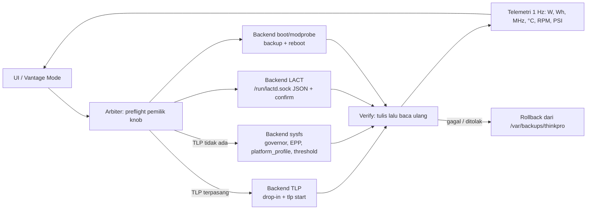

# ThinkPro Vantage — Audit & Rencana Revamp

- **Repo:** `/home/arkhimuttaqina/repo/thinkpro-vantage` (thinkutils 0.2.0, Tauri v2, Rust + vanilla JS)
- **Mesin audit:** Lenovo ThinkPad, AMD Ryzen 5 PRO 5650U (Cezanne) + Radeon Vega iGPU, CachyOS, kernel `7.3.0-2-cachyos-bore-lto`, GNOME Shell 51.1
- **Status:** draft v1. Setiap klaim di bawah berasal dari probe langsung di sesi ini (lihat §9), bukan asumsi.

---

## 1. Ringkasan

1. **Aplikasi sekarang = 63 command, 19 modul Rust, 5.798 LOC CSS dark-only.** Fitur jalan: fan (ibm-fan + curve), battery, performance, monitor, security (ClamAV), biometrics/PAM, MCP server, GNOME extension. Fondasinya layak dilanjutkan, tapi tanpa design system dan tanpa satu lapis power-abstraction.
2. **Mesin ini punya tiga penulis knob, bukan nol.** PPD aktif (`power-saver`), LACT aktif (`performance_level: low` di GPU), `scx_loader` + `ananicy-cpp` aktif. Hasilnya box dipaku ke hemat daya di tiga tempat sekaligus. TLP **belum terpasang**.
3. **Jalur resmi TLP sudah tersedia:** `tlp 1.10.2` + `tlp-pd 1.10.2` di repo `extra`; `tlp-pd` **Provides** `power-profiles-daemon` dan **Conflicts** `power-profiles-daemon`/`tuned-ppd` → quick-settings GNOME tetap hidup. Jadi "TLP + tlp-pd", bukan "tlp" telanjang.
4. **Yang bisa dibuka penuh:** 61 kunci di `defaults.conf` + 120 kunci di template `/etc/tlp.conf` + `START/STOP_CHARGE_THRESH_BAT0/1` + file device list (`tlp-usblist`, `tlp-pcilist`, `tlp-radio-device`) + seluruh perintah `tlp` (`start|ac|bat|performance|balanced|power-saver|setcharge|chargeonce|fullcharge|discharge|recalibrate|usb|radio|bayoff|diskid`). TLPUI parity tercapai, ditambah hal yang TLPUI tidak punya (telemetri, verifikasi tulis, rollback, conflict explainer).
5. **Batas keras yang harus diakui di UI:** watt baterai bisa (sysfs, tanpa root); watt paket CPU **tidak** (RAPL `0400`); overdrive/curve GPU **tidak** (daemon sendiri bilang `amdgpu_overdrive_enabled: false` untuk APU ini); cmdline kernel butuh root + reboot; fan `thinkpad_acpi` butuh `fan_control=1` (modprobe + reboot).

---

## 2. Audit mesin — siapa pemilik knob sekarang

| Knob | Pemilik sekarang | Nilai | Catatan |
|---|---|---|---|
| `platform_profile` | PPD | `low-power` | PPD unit `disabled` tapi proses `active` (dbus-activated) |
| `cpufreq/energy_performance_preference` | PPD | `power` | driver `amd_pstate`, mode `active` |
| `amdgpu power_dpm_force_performance_level` | **LACT** | `low` | dipin; driver default `auto` |
| charge threshold BAT0 | BIOS/EC | `start 95 / stop 100` | `charge_control_*` + `charge_behaviour` ada → NATACPI penuh |
| wifi power save | NetworkManager | `on` | TLP belum ada |
| USB autosuspend | default kernel | `auto` | tidak ada denylist |
| scheduler / compaction | `scx_loader` + `ananicy-cpp` | aktif | penulis keempat |
| fan | `thinkpad_acpi` | `auto` | `fan_control=N`, param `0444` → tulis manual butuh modprobe + reboot |
| RAPL package power | kernel | `EACCES` | `/sys/class/powercap/intel-rapl:0/energy_uj` root-only |
| TLP | — | tidak ada | `/run/tlp` tidak ada |

### 2.1 Hard- dan software (verified)

| Item | Nilai |
|---|---|
| DMI | sys_vendor Lenovo, subsystem PCI `17AA:5095`, board Lenovo |
| CPU | Ryzen 5 PRO 5650U, 6C/12T, max 2301 MHz, driver `amd_pstate` (`active`) |
| GPU | `1002:1638` Cezanne, RADV/Mesa 26.2.5, `amdgpu_overdrive_enabled: false` |
| Battery | Celxpert `5B10W51815`, Li-poly, 57,0 Wh design / 56,98 Wh full (**99,6% health**), 111 cycle, `power_now` 6,95 W (discharge) |
| Boot | Limine ×2 (Boot0003/0004) di dua ESP + entry Windows/Fedora/Ubuntu; `/boot/loader/entries` juga ada; `/boot` root-only |
| cmdline | `quiet nowatchdog splash rw rootflags=subvol=/@ root=UUID=6460e781-…` |
| modprobe.d | hanya `blacklist-raydium.conf` |
| LACT | 0.10.1, `lactd` enabled+active, socket `/run/lactd.sock` (root:wheel, `srw-rw----`) — **API bisa diakses dari user ini** (sudah diuji: `ping`, `list_devices`, `system_info`, `device_info`) |
| PPD | unit `disabled` tapi `active`; `/var/lib/power-profiles-daemon/state.ini`: `Profile=power-saver`, `battery_aware=true`, `trickle_charge=true`, `amdgpu_dpm=false` |
| GNOME | Shell 51.1; extension `thinkutils@tysontranthai.site` **tidak terinstal**, dan metadata repo hanya menyatakan dukungan GNOME 45–48 |
| CachyOS | `scx_loader` enabled+active, `ananicy-cpp`, `cachyos-kernel-manager`, kernel `-lts` & `-rt-bore-lto` ikut terpasang |

### 2.2 Temuan yang mengubah rencana

1. **PPD `state.ini` menyimpan `power-saver` lintas reboot.** `battery_aware` bereaksi pada *transisi*, bukan state awal → mesin boot langsung ke mode hemat. Ini persis jebakan yang terjadi sekarang.
2. **GPU dipin `low` oleh LACT dan akan tetap begitu.** Selama pin ini ada, `RADEON_DPM_PERF_LEVEL_*` milik TLP akan dilawan. Arbiter wajib tahu siapa yang menang.
3. **RAPL tidak bisa dibaca user biasa.** Meter daya paket harus lewat helper/polkit, dan itu opt-in — bukan default.
4. **`thinkpad_acpi` di-load tanpa `fan_control=1`** (param `0444`, nilai `N`) → kontrol fan manual mustahil sampai ada entri modprobe + reboot. Aplikasi sekarang sudah mendiagnosis ini (`environment.rs:371-385`) dan menyuruh user menempel `tee /etc/modprobe.d/…`; itu sendiri yang harus kita otomatiskan.
5. **Jalur TLP yang ada sekarang adalah stub.** `performance.rs:205` mencoba `powerprofilesctl` lalu fallback `sudo tlp`; `sudo` di GUI Tauri tidak akan pernah bekerja (tidak ada TTY), dan perintah TLP 1.10 yang benar adalah `tlp performance|balanced|power-saver|ac|bat`, bukan nama profil PPD.
6. **Repo ini bukan git repository** (tidak ada `.git`) padahal CLAUDE.md mengasumsikan alur commit/tag/CI. Tidak ada rollback untuk refactor besar → P0 wajib `git init` + baseline tag.
7. **TLP menulis di dua lapis dengan prioritas berlawanan intuisi:** urutan merge `tlp-readconfs` = `defaults.conf` → `/etc/tlp.d/*.conf` (lexical) → **`/etc/tlp.conf` (menang di atas drop-in)**. Jadi drop-in kita bisa di-override diam-diam oleh `tlp.conf`. UI wajib menampilkan provenance per kunci (file + baris).
8. **Battery care di ThinkPad ini lengkap:** TLP plugin `bat.d/05-thinkpad` mendeteksi NATACPI dengan `charge thresholds, chargeonce, discharge, recalibrate` → semua fitur itu layak diekspos.

---

## 3. Audit aplikasi

### 3.1 Peta kode

| Lapis | Isi |
|---|---|
| Backend | 19 modul `src-tauri/src/*.rs` (±7.0k LOC): `fan_control` 813, `security` 770, `mcp` 760, `biometrics` 932, `pam` 672, `fan_curve` 651, `performance` 639, `battery` 515, `monitor` 521, `environment` 903, `settings` 507 |
| Command | 63 `#[tauri::command]`, terdaftar di `lib.rs` `generate_handler!` |
| Frontend | `src/js` (±3.4k LOC) + `src/templates/*.html`; 12 file CSS, 5.798 LOC; entry `src/styles.css` (`@import`) |
| Packaging | `packaging/` (aur, copr, helper, polkit, ppa), `ubuntu-installer.sh`, `.github/workflows/ci.yml`, Husky + lint-staged |

**Command per modul:** battery 4 · biometrics 9 · fan_control 5 · fan_curve 3 · gnome_extension 4 · mcp 3 · monitor 2 · pam 3 · performance 6 · permissions 2 · security 5 · settings 6 · system_info 1 · auth 1 · environment 1 · lib (window) 7.

### 3.2 Arsitektur privilege (aset terbaik repo ini)

- Helper bash terinstal di `/usr/local/bin/…` dengan **whitelist exact-match** (`fan_control.rs:58`), polkit rule digenerate dari daftar path kandidat (`polkit_rule()`), plus gate `subject.local && subject.active` supaya sesi SSH tidak dapat eksekusi root-adjacent.
- Rule terketat: hanya helper itu, bukan shell bebas.
- **Rencana:** generalisasi pattern ini jadi `thinkpro-ctl` dengan **verb whitelist**, bukan path whitelist baru per fitur.

### 3.3 UI/UX sekarang

| Aspek | Kondisi | Konsekuensi |
|---|---|---|
| Tema | satu `:root` di `common.css:3`, komentar "Legion Red Theme", `tauri.conf.json` `theme: "Dark"` | tidak ada light mode, tidak ada token semantik |
| Token | 23 variabel didefinisikan, **15** dipakai | 143 literal hex (43 unik) + 110 literal `rgba()` tersebar; `rgb(228 0 43 / …)` muncul 21× |
| Aksen | `--red-primary: #e4002b`, plus `#e2231a` muncul 2× | arah sudah benar (merah Lenovo), tapi tidak konsisten |
| Loading | hanya `logPanel.js` dan `security.js` punya spinner | sisanya fire-and-forget: klik → tidak ada feedback |
| Shell | sidebar 9 item dengan SVG inline per item; titlebar custom (`decorations: false`, `transparent: true`) berisi 3 stat | tidak ada versi aplikasi di sidebar, tidak ada rail/collapse, tidak ada hero status |
| Interaksi | `dialog.js` untuk modal; tidak ada toast/banner/diff-preview | tidak ada jalur untuk "review sebelum apply" yang dibutuhkan editor TLP |

---

## 4. Sejauh mana improv-nya bisa pergi

Legend kebutuhan: **H** = helper/polkit · **R** = reboot · **X** = butuh daemon pihak ketiga.

| # | Kapabilitas | Bisa sampai mana | Butuh | Batas nyata |
|---|---|---|---|---|
| 1 | **Vantage Modes** (Quiet/Balanced/Performance/Saver) satu klik | Agregasi 6 knob: `platform_profile` + EPP + governor + boost + profil LACT + perintah `tlp` | H, X | hanya efektif kalau tiap knob punya **satu** pemilik; makanya arbiter dulu |
| 2 | **Editor TLP penuh (parity TLPUI+)** | 120 kunci template + 61 default, row AC/BAT/SAV, enum+unit+default dari komentar `defaults.conf`/`tlp.conf` yang dibaca runtime, provenance per kunci, diff vs default, tulis ke `/etc/tlp.d/99-thinkpro.conf`, apply via `tlp start`, rollback | H | kunci baru di TLP versi mendatang otomatis ter-cover (schema runtime, bukan YAML yang di-vendor) |
| 3 | **Battery care** | threshold start/stop, `charge_behaviour` (inhibit/force-discharge), `chargeonce`, `discharge`, `recalibrate` (job streamed), health/cycle, runtime estimate | H (untuk tulis) | discharge/recalibrate = perintah interaktif panjang → harus jadi job dengan output live |
| 4 | **Telemetri daya** | watt instan dari `power_now` (**tanpa root**, terverifikasi 6,95 W), integrasi Wh per sesi, rata-rata, grafik, PSI `/proc/pressure` | — / H untuk RAPL | RAPL package power root-only → opt-in; tanpa itu tidak ada angka "CPU saja" |
| 5 | **LACT/G** | klien JSON ke `/run/lactd.sock`: `list_devices`, `device_info`, `device_stats`, `device_clocks_info`, `get_gpu_config`/`set_gpu_config` + `confirm_pending_config`, `set_performance_level`, profil, `power-limit`, `detach/reattach` | X | APU ini tidak punya overdrive/curve/power-cap → tampilkan sebagai *unavailable + alasan*, jangan kontrol mati |
| 6 | **CPU & kernel** | `amd_pstate` mode, EPP, governor, min/max perf %, CPB/boost, HWP dyn boost | H, R untuk sebagian | `passive` butuh cmdline + reboot; `amd_pstate` mode runtime tidak bisa diganti |
| 7 | **Kernel/boot** | editor cmdline (Limine + `loader/entries` + grub bila ada), editor `modprobe.d`, baca nilai `sysctl` CachyOS, deep-link ke `cachyos-kernel-manager` | H, R | `/boot` root-only; setiap perubahan butuh reboot; jangan duplikasi kernel-manager |
| 8 | **Cooling** | kontrol ibm-fan + curve (sudah ada), thermal mode ala *Intelligent Cooling* (mode → `platform_profile` + preset curve), verifikasi tulis-baca, fallback `hwmon` PWM | H, R untuk fan manual | EC fan table tidak bisa diubah; tanpa `fan_control=1` hanya mode `auto` |
| 9 | **Ownership Arbiter** (diferensiasi) | deteksi pemilik per knob + matriks konflik + aksi serah-terima (disable PPD, pasang `tlp-pd`, lepas pin LACT, matikan wifi powersave NM) | H | ini yang tidak dimiliki TLPUI / LACT / tlp-panel / PPD — semuanya penulis tunggal yang saling bertabrakan |
| 10 | **Profil otomatis AC/BAT + event** | jalankan mode saat colok/cabut, saat suhu tinggi, saat idle; log keputusan | X | `TLP_AUTO_SWITCH` dan `LACT auto_switch_profiles` sudah ada → kita harus **memilih satu** yang memegang AC/BAT, bukan dua |
| 11 | **MCP + AI** | modul baru diekspos ke MCP server yang sudah ada (`mcp.rs`) → agen bisa baca status & ganti mode | — | gratis, tinggal daftarkan tool |
| 12 | **GNOME Shell** | indikator fan/suhu (sudah ada) + port ke Shell 49–51, quick power mode via `tlp-pd` | — | extension sekarang **tidak terinstal** dan hanya menyatakan 45–48 |

### 4.1 Yang tidak bisa (jangan dijanjikan)

- Fan table/EC custom, kontrol arus charge, kalibrasi sel: di luar `thinkpad_acpi`.
- Undervolt / curve optimizer GPU: APU Cezanne tidak didukung (`amdgpu_overdrive_enabled: false`); RDNA ke atas baru bisa.
- Watt paket CPU tanpa privilege: RAPL `0400`.
- Perubahan cmdline tanpa reboot.
- Atribusi energi per proses tanpa cgroup/RAPL (hanya bisa didekati lewat PSI).

---

## 5. Arsitektur target

### 5.1 Modul backend baru (`src-tauri/src/power/`)

| File | Tanggung jawab | Command publik (contoh) |
|---|---|---|
| `arbiter.rs` | deteksi pemilik (binari, unit systemd, socket, proses), matriks konflik, klasifikasi tiap knob → `Tlp` / `Sysfs` / `Ppd` / `Lact` / `ReadOnly`, daftar aksi serah-terima | `power_owners`, `power_conflicts`, `power_handoff` |
| `tlp.rs` | parse `defaults.conf` + `/etc/tlp.conf` + `tlp.d/*.conf` (schema & provenance), baca via `tlp-readconfs --cdiff`, tulis drop-in, jalankan `tlp`, parse `tlp-stat` per seksi | `tlp_status`, `tlp_schema`, `tlp_config`, `tlp_save`, `tlp_apply`, `tlp_action`, `tlp_stat` |
| `lact.rs` | klien unix-socket JSON (newline-delimited), typed command, alur pending-config/confirm, profil | `lact_status`, `lact_devices`, `lact_config`, `lact_set`, `lact_confirm`, `lact_profiles` |
| `telemetry.rs` | sampler 1 Hz (baterai, suhu, fan, freq, PSI) + 5 s (RAPL bila helper ada), ring buffer, event Tauri | `telemetry_start`, `telemetry_snapshot` |
| `kernel.rs` | `amd_pstate`, EPP, governor, boost, `modprobe.d`, cmdline (Limine/systemd-boot/grub), baca `sysctl`, deep-link kernel-manager | `kernel_status`, `kernel_apply`, `modprobe_write`, `cmdline_write`, `cmdline_backup` |
| `profiles.rs` | definisi Vantage Modes + pipeline apply berurutan & transaksional | `modes_list`, `mode_apply`, `mode_preview` |
| `verify.rs` | tulis → baca ulang → laporkan; mendeteksi "knob palsu" (nilai diterima tapi tidak berubah) | dipakai internal |

### 5.2 Helper & polkit

Helper sekarang hanya fan. Generalisasi jadi **satu** helper `thinkpro-ctl` dengan verb whitelist (argumen divalidasi per verb, bukan regex bebas):

```
thinkpro-ctl fan <auto|full-speed|0..7|watchdog 30>
thinkpro-ctl sysfs-set <allowlisted-path> <value>      # governor, epp, boost, platform_profile, threshold
thinkpro-ctl tlp <start|performance|balanced|power-saver|ac|bat|setcharge ...|chargeonce|fullcharge|usb|radio ...>
thinkpro-ctl tlp-stat <seksi>                          # output root-only
thinkpro-ctl config-write <tlp.conf|modprobe.conf> <stdin>   # + backup otomatis
thinkpro-ctl boot-cmdline <get|set> <stdin>            # backup + validasi
thinkpro-ctl rapl-read                                 # opt-in
```

Polkit rule tetap: hanya path helper ini, `subject.local && subject.active`, grup wheel. Tidak ada shell bebas — argumen divalidasi di dalam helper.

### 5.3 State & file di disk

| Path | Isi |
|---|---|
| `/etc/tlp.d/99-thinkpro.conf` | tulisan config TLP kita (drop-in, tidak menyentuh `/etc/tlp.conf` user) |
| `/etc/modprobe.d/99-thinkpro.conf` | `options thinkpad_acpi fan_control=1`, param amdgpu |
| `/var/backups/thinkpro/` | snapshot sebelum tulis (drop-in, modprobe, cmdline, timestamp) |
| `/etc/thinkpro-vantage/state.json` | preferensi sistem-level (mode terakhir, kebijakan arbiter) |
| user store (tauri-plugin-store) | preferensi UI, telemetry opt-in |

### 5.4 Pipeline mutasi (satu jalur untuk semua tulisan)



**Aturan gating (inti permintaan):**

| Kondisi mesin | Yang terbuka | Yang terkunci |
|---|---|---|
| `tlp` + `tlp-pd` terpasang | seluruh halaman Power (120 kunci, 3 profil TLP, battery care, `tlp-stat`) | kontrol sysfs langsung untuk knob yang dimiliki TLP (read-only) |
| hanya PPD | mode terbatas: 3 profil PPD + `trickle_charge`/`amdgpu_dpm`/`amdgpu_panel_power`, sysfs governor/boost via helper | halaman TLP, thresholds per profil, semua kunci TLP — plus banner + tombol "pasang TLP + tlp-pd" |
| TLP ada, LACT ada | GPU = milik LACT, drop-in TLP **tidak** memuat `RADEON_DPM_*` | AI-generated tab `RADEON_DPM_*` diberi label "dimiliki LACT" |

### 5.5 Data flow frontend

- Satu sampler Rust → event `power://telemetry` → **satu** store JS (`state.js`) → komponen subscribe. Tidak ada polling per view.
- Setiap pemanggilan backend dibungkus helper `invokeState(name, args)` yang mengembalikan `{idle|loading|ready|error}` dan otomatis men-disable kontrol + memunculkan toast; `logPanel` dipakai ulang untuk job panjang (`tlp discharge`, `recalibrate`, `clamav scan`).

---

## 6. UI/UX — arah Lenovo Vantage

### 6.1 Prinsip yang diambil dari Vantage

Vantage bekerja karena tiga hal: **satu hero status** (kesehatan perangkat, bukan daftar angka), **kartu per domain** (Device/Power/Security/Support), dan **mode sebagai konsep pertama** (Intelligent Cooling / thermal mode / battery care) — user memilih niat, aplikasi yang menerjemahkan ke knob. Kita adopsi ketiganya, dengan lapisan yang Vantage tidak punya: **kejujuran pemilik knob** (kartu bisa bilang "nilai ini dipegang PPD; TLP tidak terpasang").

### 6.2 Palet & token

Aksen utama dari identitas resmi Lenovo (signature red) — repo sudah menyentuhnya (`#e2231a` 2×, `#e4002b` sebagai `--red-primary`), kita jadikan satu skala:

| Token | Nilai | Pakai |
|---|---|---|
| `--accent` | `#e2231a` | aksi primer, mode aktif, aksen grafik |
| `--accent-hover` | `#c81c15` | hover/pressed |
| `--accent-soft` | `color-mix(in srgb, var(--accent) 15%, transparent)` | chip, badge, focus ring |
| `--accent-glow` | `color-mix(in srgb, var(--accent) 30%, transparent)` | hero, shadow aktif |
| surface | `--bg` `#141414` / `--card` `#1e1e1e` / `--card-hi` `#262626` / `--border` `#333` | dark-first |
| teks | `--text` `#f5f5f5` / `--muted` `#a3a3a3` / `--faint` `#737373` | kontras AA |
| status | `--ok` `#22c55e` · `--warn` `#f59e0b` · `--danger` `#ef4444` · `--info` `#3b82f6` | konsisten menggantikan 143 literal hex |
| grafik | `--c1…--c6` | CPU/GPU/baterai/suhu/fan/watt |
| skala | spacing 4/8/12/16/24/32, radius 6/10/14/999, elevasi 3 tingkat, durasi 120/200/320ms | menghapus nilai ad-hoc |
| tipografi | 12/13/14/16/20/28 px, tabular-nums untuk semua angka | angka tidak "goyang" saat live |

Light mode: disiapkan sebagai `[data-theme="light"]` di layer token yang sama (PPD/`theme` existing sudah punya `light|dark|auto`), tapi default tetap dark seperti sekarang.

### 6.3 Information architecture

| View | Isi | Sumber | Kontrol |
|---|---|---|---|
| **Home** | hero: mode aktif, sumber daya (AC/BAT), watt, sisa waktu, health baterai; 4 kartu cepat (CPU/GPU/Suhu/Fan); banner konflik bila ada | telemetry + arbiter | ganti mode |
| **Modes** | Quiet · Balanced · Performance · Saver; preview "knob apa saja yang akan berubah" sebelum apply | `profiles.rs` | apply/undo |
| **Power (TLP)** | 8 grup kunci (CPU, Platform, GPU, Disk, PCIe, Radio/USB, Battery, General) dengan baris `AC | BAT | SAV`, badge sumber nilai (default/drop-in/tlp.conf), diff, tombol apply + rollback | `tlp.rs` + `tlp-readconfs` | tulis drop-in, `tlp start` |
| **Battery** | SOC, watt, Wh sesi, health/cycle, threshold slider, chargeonce/discharge/recalibrate, charge behaviour | sysfs + `tlp` | tulis (helper) |
| **CPU** | driver amd_pstate, EPP per profil, governor, min/max %, boost, freq per core live | sysfs | tulis (helper) |
| **GPU (LACT)** | device info, stats, clocks, perf level, profil, auto-switch, fan/power-cap bila device mendukung | `lactd` JSON | set + confirm |
| **Kernel** | cmdline aktif vs editor, modprobe.d, sysctl CachyOS, deep-link kernel-manager | `/proc/cmdline`, file boot | tulis + backup + badge reboot |
| **Cooling** | mode thermal, level fan, editor kurva, sensor, verifikasi tulis-baca | `/proc/acpi/ibm/fan`, hwmon | tulis (helper) |
| **Telemetry** | strip chart watt/Wh/suhu/fan, log keputusan arbiter & mode switch | sampler | ekspor CSV |
| **Security** | tetap (ClamAV, biometrics) dengan komponen baru | ada | ada |
| **Settings** | helper/polkit, TLP vs PPD, opt-in RAPL, tema, tray, auto-start, reset config | ada | ada |

### 6.4 Komponen baru (plain JS, tanpa framework)

`status-hero` · `stat-tile` · `card` · `mode-selector` · `triple-row` (AC/BAT/SAV) · `slider-field` · `segmented` · `data-table` + skeleton · `banner` (ok/warn/danger/info, khusus konflik pemilik) · `toast` · `diff-modal` · `empty-state` · `busy-overlay` (progress indeterminate) · `job-console` (reuse `logPanel`).

### 6.5 Disiplin loading & error

| Situasi | Perilaku |
|---|---|
| Muat data view | skeleton kartu, bukan layar kosong |
| Aksi tulis | kontrol disabled + spinner inline + toast hasil (sukses/gagal) |
| Aksi panjang (`tlp discharge`, scan) | job + `job-console` streaming output, bisa dihentikan |
| Konflik pemilik | banner di atas view + badge di kontrol, plus tombol serah-terima |
| Knob palsu (nilai diterima, tidak berubah) | badge "tidak diterapkan" dari `verify.rs`, bukan notifikasi palsu sukses |

---

## 7. Fase kerja

Setiap fase selesai = ada smoke run nyata + screenshot, bukan "kompilasi lolos".

| Fase | Deliverable | Acceptance | Verifikasi |
|---|---|---|---|
| **P0 — Fondasi & higiene** | `git init` + baseline tag; identitas produk final (keputusan D3); buang jalur `sudo tlp` palsu; skeleton `power/`; README/docs dipisah per domain | `cargo check` + `npm run lint` hijau, tag `v0.2.0-baseline` ada, tidak ada `Command::new("sudo")` | jalankan `npm run tauri dev`, app hidup |
| **P1 — Design system & shell** | `styles/tokens.css` (dark+light), migrasi 12 file CSS ke token, rail sidebar + versi di bawah judul app, hero, komponen inti, `invokeState` helper | 0 literal hex di komponen (kecuali file token), setiap invoke punya loading/error state | screenshot Home/Modes/Battery; audit grep literal hex = 0 |
| **P2 — Arbiter & Modes** | deteksi pemilik, matriks konflik, dashboard ownership, `profiles.rs` + preview & apply transaksional | mode Quiet/Balanced/Performance mengubah 4+ knob nyata dan dapat diverifikasi baca-ulang | jalankan mode Performance → `platform_profile`, EPP, GPU level, governor berubah; undo mengembalikan |
| **P3 — Modul TLP** | parser schema runtime, editor 8 grup, provenance, drop-in writer, `tlp-start`, viewer `tlp-stat`, battery care penuh, rollback | dengan TLP terpasang, satu kunci ditulis → `tlp start` → `tlp-stat -c` menunjukkan nilai baru; tanpa TLP halaman terkunci + CTA | tes dua kondisi (TLP ada/tidak), cek `tlp-stat -c` + `--cdiff` |
| **P4 — Modul LACT** | klien socket, halaman GPU, profil + auto-switch, lepas pin stale, `detach/reattach` | `set_performance_level` via app terlihat di `device_info`; pending config ter-konfirmasi/rollback saat tidak dikonfirmasi | probe socket dari app + `lact cli info` |
| **P5 — Telemetri** | sampler, grafik, Wh sesi, PSI, RAPL opt-in lewat helper | watt tampil tanpa root; RAPL tampil setelah opt-in helper | bandingkan angka app dengan `power_now` mentah + `lact cli stats` |
| **P6 — CPU & Kernel** | halaman CPU, editor cmdline/modprobe dengan backup + badge reboot, baca sysctl | tulis cmdline → file boot berubah + backup ada + banner reboot muncul | baca balik file boot via helper, reboot opsional |
| **P7 — Cooling** | fan + curve lama dipindah ke komponen baru, thermal mode, verifikasi tulis, fallback hwmon, penawaran `99-thinkpro.conf` fan_control | setelah modprobe + reboot, level manual benar-benar berubah (baca `/proc/acpi/ibm/fan`) | set level 3 → baca RPM; uji false-knob |
| **P8 — Ekosistem** | MCP tools baru, port GNOME ext ke 45–51, packaging (AUR/deb/rpm) dengan `optdepends: tlp, tlp-pd, lact`, docs, CI | `gnome-extensions info` di Shell 51 statusnya enabled; paket terinstal di Arch | install paket lokal + jalankan app dari paket |

---

## 8. Risiko & keputusan terbuka

### 8.1 Risiko teknis

| Risiko | Dampak | Mitigasi |
|---|---|---|
| Tiga penulis knob | nilai "kembali sendiri", user bingung | arbiter + banner + verify-after-write; tidak pernah menulis knob milik daemon lain tanpa pernyataan |
| Pindah PPD → `tlp-pd` | sesi GNOME kehilangan power mode sesaat, butuh restart GNOME/relogin | aksi eksplisit "serah-terima" dengan daftar perubahan, jangan pernah otomatis |
| `tlp.conf` menang atas drop-in | nilai kita di-override diam-diam | provenance per kunci + peringatan saat ada override |
| `tlp restart` memutus pengaturan sesaat | perangkat (wifi/USB) reset | apply per grup, konfirmasi, opsi "apply saat idle" |
| Tulis `/boot` salah | mesin tidak boot | backup + validasi + hanya satu entri yang diubah + instruksi rollback dari live USB |
| RAPL via helper | permukaan privilege bertambah | hanya `rapl-read`, tidak ada argumen, opt-in default off |
| Repo tanpa VCS | refactor tak bisa dibatalkan | `git init` + baseline tag sebelum sentuh apa pun (P0) |

### 8.2 Lisensi

- **TLPUI adalah GPL-2.0** dan mem-vendor `defaults` per versi + YAML schema. **Jangan menyalin** YAML/teks mereka ke repo ini.
- Sebagai gantinya: parse `defaults.conf` + `/etc/tlp.conf` **milik instalasi TLP di mesin user** saat runtime (`tlp-readconfs` milik TLP juga dipakai lewat proses, bukan di-link). Tidak ada redistribusi teks/kode GPL.
- LACT GPL-3.0: kita bicara lewat protokol JSON di socket, tidak men-link kode → aman.
- tlp-panel GPL-3.0: hanya jadi referensi ide (deteksi "fake knob", panel aksi cepat), tidak ada kode yang disalin.

### 8.3 Keputusan yang perlu diambil

- **D1 TLP:** pasang `tlp` + `tlp-pd` sekarang (halaman penuh terbuka), atau kirim dulu dengan mode terkunci sampai user memutuskan?
- **D2 GPU:** LACT tetap pemilik tunggal GPU (app jadi proxy API-nya) atau app ambil alih `power_dpm_force_performance_level`?
- **D3 Identitas:** ganti `productName`/identifier (`com.vietanhnv.thinkutils` → `…thinkpro-vantage`) + nama paket, atau ganti branding UI saja?
- **D4 Kernel page:** editor cmdline/modprobe penuh (dengan backup + badge reboot) atau read-only dulu?
- **D5 RAPL:** helper `rapl-read` opt-in (dapat angka watt CPU) atau lewati saja?

---

## 9. Bukti verifikasi sesi ini

| Probe | Hasil |
|---|---|
| `lact --help` + socket `ping`/`list_devices`/`system_info`/`device_info` via `/run/lactd.sock` | ok; LACT 0.10.1; device `1002:1638-17AA:5095`; `amdgpu_overdrive_enabled: false` |
| `systemctl is-enabled/is-active` tlp, tlp-pd, power-profiles-daemon, lactd, scx_loader | tlp tidak ada; PPD `disabled`/`active`; lactd `enabled`/`active`; scx_loader `enabled`/`active` |
| `cat /var/lib/power-profiles-daemon/state.ini` | `Profile=power-saver`, `battery_aware=true`, `trickle_charge=true` |
| `powerprofilesctl list-actions` / `list` / `get` | 3 profil, 3 aksi; aktif `power-saver` |
| `cat /sys/firmware/acpi/platform_profile` + EPP + `amd_pstate/status` | `low-power`, `power`, `active` |
| `cat /sys/class/drm/card1/device/power_dpm_force_performance_level` | `low` (dipin) |
| `for f in /sys/class/power_supply/BAT0/*` | `power_now=6954000` µW; `energy_full=56980000` vs design `57000000`; `cycle_count=111`; `charge_control_start/end_threshold=95/100`; `charge_behaviour=[auto] inhibit-charge force-discharge` |
| `cat /sys/class/powercap/intel-rapl:0/energy_uj` | Permission denied |
| `cat /sys/module/thinkpad_acpi/parameters/fan_control` (`ls -l`) | nilai `N`, mode `-r--r--r--` |
| `cat /proc/cmdline`, `efibootmgr`, `ls /etc/default/grub /boot/limine.conf /boot/loader/entries` | Limine ×2; `/boot/limine.conf` & `/boot/loader/entries` ada tapi root-only; tidak ada `grub` |
| `pacman -Si tlp` / `tlp-pd` | 1.10.2-1; `tlp-pd` Provides `power-profiles-daemon`, Conflicts `power-profiles-daemon`, `tuned-ppd` |
| unduh `tlp-1.10.2-1-any.pkg.tar.zst`, ekstrak `/usr/share/tlp/defaults.conf` + `/etc/tlp.conf` | 61 kunci default; 120 kemunculan kunci di template; blok komentar memuat deskripsi/enum/`Requires`/`Default` → parseable runtime |
| baca `tlp-readconfs` + `rename.conf` + `deprecated.conf` + `bat.d/05-thinkpad` | urutan merge default→drop-in→`tlp.conf`; dukungan rename/deprecation; NATACPI: `charge thresholds, chargeonce, discharge, recalibrate`; range START 0..96..99, STOP 1..100 |
| `lact --help`, `lact cli --help` | tersedia `list/info/stats/snapshot/power-limit/profile/detach/reattach` |
| `gnome-extensions list` + `info thinkutils@…` | extension belum terinstal; Shell 51.1 |
| audit CSS (`src/styles/*.css`) | 5.798 LOC; 23 var didefinisikan / 15 dipakai; 143 hex (43 unik) + 110 `rgba()`; satu `:root` "Legion Red" |
| grep `#[tauri::command]`, `generate_handler!`, `powerprofilesctl`, `sudo tlp` | 63 command; `performance.rs:205` probe PPD, fallback `sudo tlp` |
| `find <repo> -maxdepth 2 -name '.git*'` | tidak ada `.git` |
