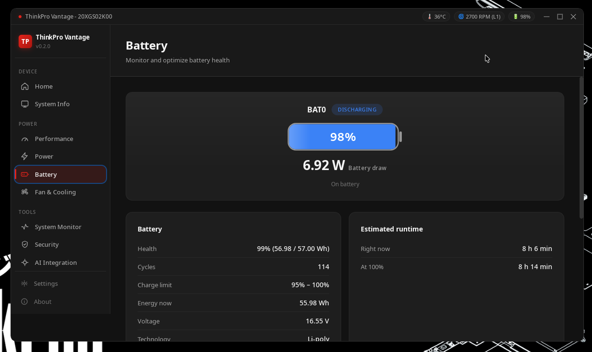

# Battery Management

Extend your battery's lifespan by years with intelligent charge management.

## Live Power

The view leads with the instantaneous reading: the wattage right now, a charge bar, the
charge state and the power source.

- **Wattage**: charging/input power while charging, draw power while discharging. A pack that
  is full or idle on AC honestly reads `0.00 W`.
- **Charge bar**: the battery's charge level, not the wattage. Green while charging, red while
  discharging, with a lightning glyph on the bar while charge is going in.
- **State line**: `Charging · 43 min`, `Discharging · 150 min`, `Full` or `Not charging` (the estimate is dropped when the hardware does not supply one).
- **Source line**: `On AC power` or `On battery`.

Each battery card below also reports its own wattage.

## Charge Thresholds

Set custom start/stop charging limits to reduce battery wear:

- **Start Threshold**: Battery begins charging when it drops below this level
- **Stop Threshold**: Battery stops charging when it reaches this level

**Recommended for longevity**: Start at 40%, Stop at 80% (the "40-80 rule").

## Battery Health

Track your battery's condition over time:
- **Capacity**: Current vs design capacity
- **Health %**: How much capacity remains
- **Charge Cycles**: Total charge/discharge cycles completed
- **Status**: Charging, discharging, or full

## Multi-Battery Support

ThinkPro Vantage detects all installed batteries — perfect for ThinkPads with dual battery setups. Each battery's status is shown independently.

## Real-time Stats

Monitor live:
- Current charge level and voltage
- Power draw (watts), per battery and combined
- Estimated time remaining, in minutes

The view refreshes every 2.5 seconds.

## How It Works

Battery data is read from `/sys/class/power_supply/BAT0|BAT1/`. Wattage comes from `power_now`, falling back to `voltage_now × current_now` when a pack does not expose it — some batteries report `power_now` as a permanent `0`, and a full pack on AC is genuinely `0 W`. Charge thresholds are written to `charge_control_start_threshold` / `charge_control_end_threshold` (the generic kernel pair), with `charge_start_threshold` / `charge_stop_threshold` as the fallback for older kernels. See [Permissions](./permissions) for access setup.
