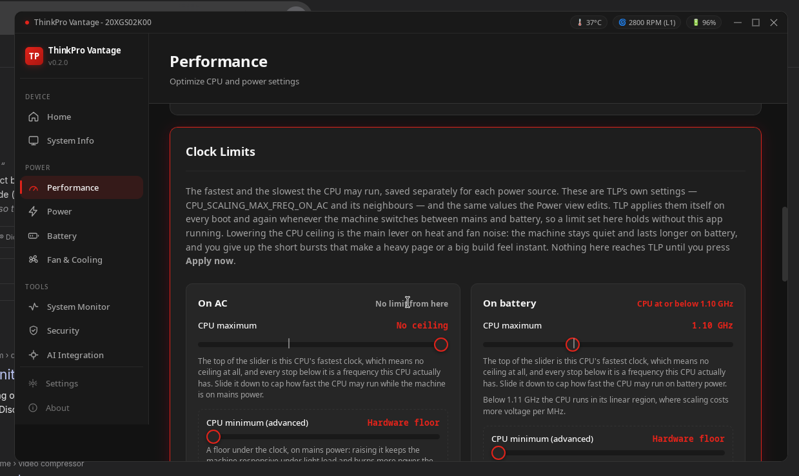

# Performance Tuning

Fine-tune how your ThinkPad manages processor power and frequency scaling.

## CPU Governor

Choose a scaling policy:

| Governor        | Behavior                             |
| --------------- | ------------------------------------ |
| **performance** | Maximum speed at all times           |
| **powersave**   | Minimum frequency for battery life   |
| **schedutil**   | Intelligent scheduling-based scaling |
| **ondemand**    | Dynamic adjustment based on load     |

## Power Profiles

System-wide power management that coordinates CPU, GPU, and other components:

- **Power Saver** — Maximum battery life
- **Balanced** — Default, adapts to workload
- **Performance** — Maximum throughput

## Clock Limits

The CPU ceilings are TLP's own settings — `CPU_SCALING_MAX_FREQ_ON_AC`,
`_ON_BAT` and `_ON_SAV`, with the matching `_MIN_FREQ_` keys — written into
`/etc/tlp.d/99-thinkpro-vantage.conf`. They are the same values the Power tab
edits: set a limit in either place and the other one shows it. TLP applies them
itself on every boot and again whenever the machine switches between mains and
battery, so a limit set here holds without this app running.

There is one ceiling per power source, which is the only axis TLP can express
one on. Power saver inherits the battery limits while its own keys are unset,
and its card says so.

| Control               | What it does                                                                                                                                                                                                                   |
| --------------------- | ------------------------------------------------------------------------------------------------------------------------------------------------------------------------------------------------------------------------------ |
| **CPU maximum**       | The fastest clock the CPU may reach on that power source. The top of the slider is this CPU's own maximum, which means no ceiling at all; every stop below it is a frequency the CPU actually has.                             |
| **CPU minimum**       | A floor under the clock for that power source. Raising it keeps the machine responsive under light load and costs battery the rest of the time. The bottom of the slider is the hardware floor.                                |
| **GPU clock ceiling** | The highest graphics clock for that power source, taken from the levels this GPU actually exposes. Like the CPU cards it has one column per source, but it is not a TLP setting: this app holds it itself, taking the GPU from LACT before writing and writing it back whenever the machine changes source, LACT takes the card over, or a reboot happens. A column with no ceiling gives the card back. |

The tick on the maximum slider marks the frequency below which this CPU leaves
its linear voltage region, where every extra MHz costs disproportionately more
voltage. It is a marker, not one of the stops.

Moving a slider stages the value and asks TLP what it would do with it; only
**Apply now** writes, and it raises the usual PolicyKit password prompt.
**Clear limits** puts that power source back to no ceiling and no floor and
writes that. TLP is restarted afterwards, so the change is in effect at once.

::: info
Clocks are ceilings, not fixed speeds. The governor still chooses any frequency
inside them, which is why a CPU ceiling and the governor are separate controls.
:::

### When LACT manages the GPU

The GPU control is the one place this app takes a knob over rather than reporting
a conflict. LACT holds the same amdgpu level through `lactd` and re-applies the
level from its own configuration whenever it applies settings, so a ceiling
written straight to sysfs would be reverted. Choosing a ceiling here asks LACT to
let go of the GPU first, through LACT's own API, and the line under the control
says which of the two is writing the level now. The write itself goes through the
same privileged helper the fan controls use, as `gpu-clock-cap <level>`, so it is
passwordless — which is what makes the re-apply below possible at all.

Each column is a separate answer, and only the column the machine is running
under is written to the GPU: the other two are remembered for when the machine is
there. The column in force is marked, and the state line says so, because the
value alone cannot — `0` is a real ceiling (the lowest level the card has) and is
not the same as no ceiling, and the line under the columns says which source's
ceiling is on the card.

Letting go is not a setting LACT keeps. There is no field in LACT's configuration
for "leave this GPU alone", so the hand-off lasts only as long as `lactd` runs: a
reboot, an upgrade, or a `systemctl restart lactd` brings the daemon back with no
memory of it and its own level goes over the ceiling. The ceiling is therefore
held by being written again. This app saves the level you chose and re-applies it
— the same take-then-write path the control uses — at startup, and within a few
seconds of noticing that it is no longer in force. The line under the control
says that rather than claiming LACT has been told to leave the GPU alone.

**No ceiling — every level** writes every level back and hands the GPU to LACT.
**Hand back to LACT** appears while this app is holding the GPU: it gives the
card up and drops the held ceiling with it, since a ceiling kept through a
hand-back would be re-applied seconds later. On a machine where LACT is not
running there is nothing to take over and nothing to hand back, and the line says
that instead.

## Turbo Boost

Toggle the CPU's boost clock on or off:

- **Enabled**: the CPU boosts above its base frequency for burst performance
- **Disabled**: reduces heat and power consumption, more predictable thermals

The clock ceiling above is the harder limit — boost can only reach as far as
that ceiling allows.

## Frequency Monitoring

Watch your CPU frequency scale in real-time with min/max ranges for each core.

::: info
Performance settings are **not** auto-applied on startup to avoid triggering a password prompt every launch. Apply them manually from the Performance page or Home dashboard.
:::
